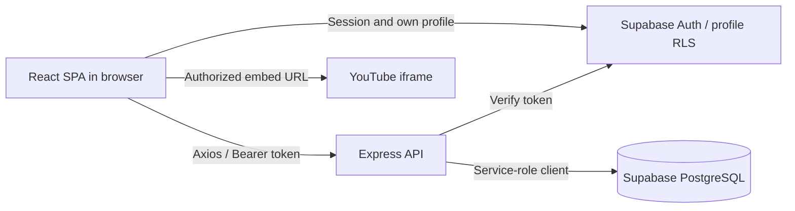

# Online Tutorial Platform: project and testability analysis

Review date: 2026-11-25. Source baseline: Git commit `c068e28`. Scope: the tutorial-platform repository. Companion documents: [roadmap](testing-roadmap.md) and [assignment checklist](assignment-checklist.md).

## 1. Review status and limits

The application source, SQL schema script, package manifests, configuration, styles, and routing have been reviewed statically. Static review means reading the code; it does not demonstrate that a running application behaves correctly. No application logic, dependencies, or database objects were changed. No application tests were executed, and no Supabase connection was made.

**Assignment source remains incomplete.** `EC4206_Group_Assignment_Task_List.docx` was not found in the workspace, including a hidden-file search. The user subsequently supplied the titles and requested content for Section 3.1 (Introduction and Test Planning) and Section 3.2 (STLC and Test Cases). Those planning/design deliverables are now available in the [test plan](section-3.1-test-plan.md), [STLC guide](section-3.2-stlc.md) and [manual matrix](section-3.2-manual-test-cases.md). Additional rubric rules and Sections 3.3–3.10 remain unverified; no missing requirements or thresholds have been invented. The original source-analysis observations below remain the baseline.

The SQL file describes intended database structure, not verified deployed structure. Supabase dashboard settings, deployed policies, authentication configuration, and real data were not inspected. Images/SVGs were inventoried as assets; their appearance was not tested. Lockfiles were parsed for metadata and key versions, not audited for vulnerabilities. Public marketing claims are not treated as tested product capabilities or reproduced as personal data in this report.

## 2. Architecture and dependencies

The browser uses Supabase directly for sign-up, login, logout, session handling, and its own profile. Other application data passes through Express. The Express client uses a service-role credential that bypasses row-level security (RLS); authorization in middleware is therefore a primary security boundary. Browser route guards improve navigation but cannot protect an API from direct requests.

| Layer | Source and observed design | Testing implication |
| --- | --- | --- |
| Frontend | [manifest](../frontend/package.json), React 19.2.8, React DOM 19.2.8, React Router 7.18.2, Axios 1.19.0; JavaScript ES modules | Use a Vite-compatible JSX runner and a DOM environment; no TypeScript migration needed |
| Build and styles | [Vite config](../frontend/vite.config.js), locked Vite 8.2.0 and React plugin 6.0.5; Tailwind 4.3.3 through [PostCSS](../frontend/postcss.config.js) | Verify chosen test-runner peer dependencies against this Vite version before installation |
| Backend | [manifest](../backend/package.json), Express 5.2.1, CommonJS, CORS, dotenv | CommonJS module mocking fits Jest; Supertest can exercise Express routers |
| Data/auth SDK | Both packages lock Supabase JS 2.111.0 | Mock auth calls and fluent database-query chains in unit tests |
| API client | [api.js](../frontend/src/services/api.js) adds the current access token through an async interceptor | Test missing session, session errors, header handling, and base URL |
| Runtime entry | [server.js](../backend/server.js) configures CORS/JSON and immediately listens on port 5000 by default | Importing this entry starts a server; initially mount routers in a test-only Express harness |
| External media | [WatchPage](../frontend/src/pages/WatchPage.jsx) derives a YouTube ID and creates an iframe; thumbnails can be remote | Stub external media for automated tests; distinguish embed construction from actual playback |

There are two independent npm packages and lockfiles, with no root package/workspace orchestration. The backend manifest names an absent `index.js` as its main entry; the implemented entry is [server.js](../backend/server.js). There is no backend start script. Existing frontend scripts are `dev`, `build`, `lint`, and `preview`. [README](../frontend/README.md) is template documentation rather than an application setup guide.

## 3. Source inventory and testable modules

| Source group | Responsibilities and proposed checks |
| --- | --- |
| [main.jsx](../frontend/src/main.jsx), [App.jsx](../frontend/src/App.jsx) | StrictMode, provider composition, navigation, skip link, fallback redirect; test refresh/deep links and duplicate-effect cleanup |
| [AuthContext](../frontend/src/context/AuthContext.jsx) | Restore session, fetch own profile, react to auth events, unsubscribe; test event ordering, profile failure, account switching, and logout |
| [frontend Supabase client](../frontend/src/services/supabase.js), [API client](../frontend/src/services/api.js) | Environment configuration, fallback values, session-to-header conversion; isolate before import |
| [ProtectedRoute](../frontend/src/components/ProtectedRoute.jsx), [AdminRoute](../frontend/src/components/AdminRoute.jsx) | Loading, guest redirect, student/admin role decisions |
| [Navbar](../frontend/src/components/Navbar.jsx), [Footer](../frontend/src/components/Footer.jsx) | Role-dependent links, unpaid badge, logout, mobile menu, Escape/focus return, hash navigation, year display |
| [HomePage](../frontend/src/pages/HomePage.jsx) | Published catalog, loading/error/empty states, 15-second timeout, abort on unmount, retry, image fallback, anchors, FAQ, sign-in-dependent links |
| [Login](../frontend/src/pages/Login.jsx), [Register](../frontend/src/pages/Register.jsx) | Required fields, email validation, loading/submission, SDK errors, navigation, confirmation-required sign-up |
| [StudentDashboard](../frontend/src/pages/StudentDashboard.jsx), [CoursePage](../frontend/src/pages/CoursePage.jsx) | Own enrolled courses, course metadata, video ordering, empty/error states, displayed payment locks |
| [WatchPage](../frontend/src/pages/WatchPage.jsx) | Authorized lesson retrieval, denied/missing video, URL parsing, fullscreen, back navigation, route changes |
| [AdminDashboard](../frontend/src/pages/admin/AdminDashboard.jsx) | Student/paid/course counts, loading and database failures |
| [ManageStudents](../frontend/src/pages/admin/ManageStudents.jsx) | Payment approval/revocation, manual enrollment/removal, cancel confirmations, duplicate requests, joined display |
| [ManageCourses](../frontend/src/pages/admin/ManageCourses.jsx) | Create/edit/publish/unpublish/delete, validation, cancel edit, cascade confirmation, open course-specific student management |
| [CourseStudents](../frontend/src/components/CourseStudents.jsx) | Enrolled/available lists, trimmed case-insensitive search, retry, joined-profile fallback, enrollment mutations, duplicate-submit guard, disabled back button |
| [ManageVideos](../frontend/src/pages/admin/ManageVideos.jsx) | Course selection, add/edit/delete, duration text, order calculation and swaps, boundary arrows, partial failures, rapid selection changes |
| [authenticate](../backend/middleware/authenticate.js), [isAdmin](../backend/middleware/isAdmin.js), [isEnrolled](../backend/middleware/isEnrolled.js) | Header/token/profile validation; admin role; payment, video-course lookup and enrollment checks; exceptions and short-circuit behavior |
| [courses router](../backend/routes/courses.js), [videos router](../backend/routes/videos.js), [students router](../backend/routes/students.js), [admin router](../backend/routes/admin.js) | All 18 method/path combinations listed below; request bodies, selection filters, response shape, ordering, errors and permissions |
| [backend client](../backend/supabaseClient.js), [server](../backend/server.js) | Credential availability, client construction, middleware/mount order, port binding; controlled startup smoke test later |
| [schema](../database_setup.sql) | Tables, nullability, defaults, relationships, constraints, trigger and RLS; real database checks only in disposable Supabase |
| [global styles](../frontend/src/index.css), [home styles](../frontend/src/pages/HomePage.css), [legacy styles](../frontend/src/App.css), [Tailwind config](../frontend/tailwind.config.js) | Responsive behavior, focus visibility, contrast, reduced motion, Sinhala rendering; legacy app stylesheet is not imported by the current app |
| [HTML entry](../frontend/index.html), [redirect rules](../frontend/public/_redirects), [public assets](../frontend/public/), [source assets](../frontend/src/assets/) | Page language/title, asset loading and SPA fallback; deployment support for redirect rules is unverified |
| [Oxlint config](../frontend/.oxlintrc.json), [root ignore rules](../.gitignore), [frontend ignore rules](../frontend/.gitignore), [backend lockfile](../backend/package-lock.json), [frontend lockfile](../frontend/package-lock.json) | Static checks, reproducibility, secret/report exclusions and tooling compatibility |

## 4. Data model

Source: [database_setup.sql](../database_setup.sql). UUIDs are identifiers; a foreign key constrains a reference only when it is non-null. A default does not imply `NOT NULL`.

| Table | Columns and constraints | Test priorities |
| --- | --- | --- |
| `profiles` | `id` UUID primary key references `auth.users` with cascade delete; nullable `name`; required `email`; nullable `role` default student with admin/student check; nullable `is_paid` default false; nullable `paid_at`; `created_at` default now | Trigger creates student role even if user metadata asks for admin; own-profile visibility; paid timestamp consistency; null/missing profiles |
| `courses` | Generated UUID primary key; required `title`; nullable `description`, `thumbnail_url`, `is_published` default false, `created_at` default now | Published filtering; blank title versus null; arbitrary URL/text and null publication behavior |
| `videos` | Generated UUID primary key; nullable `course_id` FK to courses with cascade delete; required `title` and `youtube_url`; nullable description, order index default 0, duration text, created timestamp | Course relation, missing course, valid/invalid URLs, sorting, duplicate/negative/null order values |
| `enrollments` | Generated UUID primary key; nullable `student_id` FK to profiles with cascade delete; nullable `course_id` FK to courses with cascade delete; nullable `enrolled_by` FK to profiles with delete-set-null; timestamp default now; unique `(student_id, course_id)` | Duplicate non-null pairs, invalid references, nullable pairs, removing enrollment, cascades and actor attribution |

Registration inserts into Supabase-managed `auth.users`. An after-insert trigger calls a security-definer function to insert a profile using the account email and name metadata, with role fixed to student. It does not automatically enroll or mark a student paid. Administrator provisioning is not documented in the repository.

RLS is enabled on all four public tables. Profiles have a SELECT policy restricted to the caller's own ID. Courses, videos and enrollments have admin-only `FOR ALL` policies using an own-profile role lookup. No student SELECT policy for these tables and no profile mutation policy are defined here. PostgreSQL grants, existing policies, dashboard changes and auth settings are outside the supplied script; actual behavior needs integration testing. The script is an initial setup script, with no migration history or safe repeatable reset procedure.

Deleting a course cascades to its videos and enrollments. Deleting an auth account cascades to its profile and its student enrollments, while enrollment records attributed to that profile have `enrolled_by` cleared. These checks must use a disposable local database, never production.

Payment is an account-level Boolean approved manually by an administrator. There are no payment transactions, prices, payment gateway callbacks, per-course payment records, or payment processing API to test. No quizzes, grading, learning-progress tracking, upload pipeline, or password-reset UI was found.

## 5. API inventory

All success responses currently use HTTP 200, including creation and deletion. Most caught database errors return 500 with an error message. Do not silently turn a preferred 201/400/409 contract into an alleged existing requirement. Separate characterization tests (what the code currently does) from approved requirements (what it should do).

| Method and path | Access | Input / returned data and important branches |
| --- | --- | --- |
| `GET /api/courses` | Public | Published courses, newest first; all course columns; 500 query error |
| `GET /api/courses/:id` | Public | Course plus ordered video metadata; excludes `youtube_url`; no published filter; 404 course missing/query error, 500 video-list error |
| `GET /api/videos/:id/watch` | Authenticated; admin OR paid and enrolled | Returns id, title, description, YouTube URL; 401 auth failures, 403 payment/enrollment failure, 404 video missing, 500 exceptional failures |
| `GET /api/students/courses` | Any authenticated profile | Enrollments filtered by caller ID, joined courses with null course joins removed; no role/payment/publication filter; 500 on error |
| `GET /api/admin/students` | Admin | Student-role profiles, all columns, newest first |
| `PUT /api/admin/students/:id/pay` | Admin | Body `{ is_paid }`; writes payment flag and server timestamp or null; no student-role predicate on target |
| `POST /api/admin/enroll` | Admin | Body `{ student_id, course_id }`; actor taken from authenticated profile; duplicate/FK failure currently 500 |
| `DELETE /api/admin/enroll` | Admin | JSON body `{ student_id, course_id }`; matches both; returns `{ success: true }`, including no-match deletion |
| `GET /api/admin/dashboard` | Admin | Three counts; ordinary Supabase error results not checked and null counts converted to zero |
| `GET /api/admin/courses` | Admin | All courses including drafts, newest first |
| `POST /api/admin/courses` | Admin | Entire body forwarded to course insert; returns inserted row |
| `PUT /api/admin/courses/:id` | Admin | Entire body forwarded to course update; returns row; missing row becomes 500 |
| `DELETE /api/admin/courses/:id` | Admin | Deletes course with database cascades; no-match can still succeed |
| `GET /api/admin/videos` | Admin | All video columns including URL, ordered by index; optional `course_id` query filter |
| `POST /api/admin/videos` | Admin | Entire body forwarded to video insert |
| `PUT /api/admin/videos/:id` | Admin | Entire body forwarded to video update |
| `DELETE /api/admin/videos/:id` | Admin | Delete by ID; success Boolean |
| `GET /api/admin/enrollments` | Admin | All enrollments joined to course and student profile; includes profile personal fields in authorized response |

There are no Express login/register/logout routes: those operations call Supabase Auth directly. All 14 admin endpoints share authentication and admin middleware. Test each endpoint's protection, rather than assuming one passing admin test proves all routes are secured. No centralized custom error handler, request-schema validation, pagination, rate limiter, or explicit security-header middleware appears in the server.

## 6. Authentication and authorization decision table

The client stores user/profile/loading state. The server independently calls `auth.getUser(token)` and fetches the profile on each protected request; it does not trust a client-supplied role or payment flag. Missing/invalid Bearer headers, invalid users and missing profiles yield 401. Admin middleware yields 403 for non-admin profiles. Thrown authentication exceptions yield 500.

| Caller state | Public course APIs | Own courses API | Watch existing video | Admin APIs |
| --- | --- | --- | --- | --- |
| Guest / missing token | Allowed | 401 | 401 | 401 |
| Invalid/expired token | Public API does not validate it | 401 | 401 | 401 |
| Valid account, profile missing | Public | 401 | 401 | 401 |
| Student unpaid, not enrolled | Public | Own list allowed | 403 payment | 403 |
| Student unpaid, enrolled | Public | Own list allowed | 403 payment | 403 |
| Student paid, not enrolled | Public | Own list allowed | 403 enrollment | 403 |
| Student paid, enrolled in this course | Public | Own list allowed | Allowed | 403 |
| Student paid, enrolled only in another course | Public | Own list allowed | 403 enrollment | 403 |
| Admin with valid profile | Public | Own list allowed | Allowed without payment/enrollment | Allowed |

These are **source-derived expectations, all Not Run**. For an unpaid student, payment denial precedes video existence lookup. For a paid student, missing video becomes 404 before checking enrollment. For an admin, the handler performs the video lookup. Include those branches when designing expected results.

Client paths: public `/`, `/login`, `/register`; signed-in `/my-courses`, `/courses/:id`, `/videos/:id/watch`; admin `/admin`, `/admin/students`, `/admin/courses`, `/admin/videos`. Unknown paths redirect home. A guest requesting a protected client path goes to login; a guest/student requesting an admin client path goes home. Unlike its client page, the course-detail API is public.

## 7. End-to-end flow inventory

Each flow is planned and **Not Run**. Test case IDs here are planning identifiers, not executed evidence.

| Flow | Main path and negative/alternative paths | Suggested levels |
| --- | --- | --- |
| FLOW-01 Catalog and navigation | Load published courses; empty, malformed, timeout and retry; broken image; guest vs signed-in links; FAQ/hash/mobile navigation | Components, browser/manual |
| FLOW-02 Registration and profile | Synthetic registration -> trigger creates student/unpaid profile; invalid input, SDK error, email confirmation, duplicate email, metadata role escalation attempt | Components, isolated auth/DB, E2E |
| FLOW-03 Session lifecycle | Login -> own courses -> refresh -> logout; wrong password, expired session, failed profile fetch, switching accounts, late responses | Unit/components, E2E |
| FLOW-04 Access protection | Direct client and API navigation as guest, unpaid/paid student, other student and admin; no URL disclosure on denied watch requests | Middleware, API, E2E |
| FLOW-05 Payment | Admin marks paid, checks timestamp, revokes; existing student browser may have stale profile but next server request must enforce current flag | API, DB, E2E |
| FLOW-06 Enrollments | Add/remove through Students and Course Students views; search, confirmation cancel, duplicates, failure/retry, double click, cross-course isolation | Components, API, DB, E2E |
| FLOW-07 Courses | Create draft -> edit -> publish -> catalog -> unpublish -> inspect direct detail access; delete only synthetic course and check child records | Components, API, isolated DB/E2E |
| FLOW-08 Videos | Add/edit/delete, choose course, order first/middle/last, partial swap failure, switch course during edit or fetch | Components, API, E2E |
| FLOW-09 Lesson viewing | Paid and enrolled student gets embed; unpaid/not enrolled/invalid ID denial; invalid URL, unsupported fullscreen, back and rapid route changes | Components, API, browser/manual |
| FLOW-10 Admin overview | Counts for controlled data, empty data, query errors; student denied | API, components, isolated integration |
| FLOW-11 Data access and recovery | Own-profile RLS vs another profile, student direct-table denial, admin access, constraints/cascades, offline recovery | DB integration, security, components |
| FLOW-12 Quality attributes | Keyboard and screen-reader checks, responsive admin tables, contrast, mobile media controls, deep-link refresh, bounded load and failure behavior | Accessibility/manual, browsers, performance |

## 8. Static observations and testability risks

Priorities below express testing urgency, not a verified defect severity. All runtime reproductions are **Not Run**. Convert an observation into a defect only after recording its agreed requirement, reproducible steps, expected/actual behavior and evidence.

| ID / priority | Source-grounded observation | Effect and proposed verification |
| --- | --- | --- |
| OBS-01 / High | [Course detail](../backend/routes/courses.js) queries by ID without publication filter | Anyone who knows a draft ID may retrieve metadata. Clarify whether draft means private; test public list vs direct detail and student enrolled-list behavior |
| OBS-02 / High | [Admin router](../backend/routes/admin.js) passes whole bodies to course/video insert/update; no request validation layer | Test extra writable columns, malformed UUIDs, wrong types, blank/null values, oversized data. DB constraints are not complete business validation; avoid claiming SQL injection from SDK use |
| OBS-03 / High | [Watch-page visibility](../frontend/src/pages/CoursePage.jsx) checks payment/admin only; [server enrollment middleware](../backend/middleware/isEnrolled.js) also checks course enrollment | Paid but unenrolled students can see Watch and then get denied. Test UX and backend independently; UI mismatch does not prove a server authorization bypass |
| OBS-04 / High | [Auth context](../frontend/src/context/AuthContext.jsx) does not cancel/identify profile requests; failed profile fetch leaves existing profile unchanged; initial session rejection has no catch | Delayed responses/account changes can produce stale roles/payment display; loading behavior depends on auth events. Test controlled promise ordering and failures; do not assert a permanent spinner without reproduction |
| OBS-05 / High | [Video reorder](../frontend/src/pages/admin/ManageVideos.jsx) mutates shared video objects and sends two independent updates | One update can succeed while the other fails; rapid course fetches can show stale data. Switching course during edit keeps the old video ID and can send a new course ID. Test these independently |
| OBS-06 / Medium | [Dashboard handler](../backend/routes/admin.js) ignores returned query errors and defaults counts to zero | Error may look like successful empty stats; inject returned errors as well as thrown exceptions |
| OBS-07 / Medium | [Student dashboard](../frontend/src/pages/StudentDashboard.jsx) and several admin pages log load failures but retain empty/default state; detail/watch fetch effects do not reset every state on ID change | Users may see an empty list, stale content or stale error. Test failure versus empty, then rapid route changes and recovery |
| OBS-08 / Medium | [Registration](../frontend/src/pages/Register.jsx) redirects after successful sign-up without checking whether a session exists | Confirmation-required accounts may return to login without guidance. Use local mail capture and test both confirmed and unconfirmed settings |
| OBS-09 / High | [Payment/enrollment handlers](../backend/routes/admin.js) do not constrain target IDs to student profiles; [schema](../database_setup.sql) allows nullable foreign keys and nullable role/payment flags | Test admin-profile targets, missing references, null values, duplicate non-null pairs and timestamp type consistency; agree business rules before fixes |
| OBS-10 / Medium | Several form labels in [Login](../frontend/src/pages/Login.jsx), [Register](../frontend/src/pages/Register.jsx), [ManageStudents](../frontend/src/pages/admin/ManageStudents.jsx) and [ManageVideos](../frontend/src/pages/admin/ManageVideos.jsx) lack input associations; video actions have icon-only buttons without names | Prefer accessible role/name queries; audit labels, keyboard access, touch visibility and contrast. Existing skip link and Course Students labels are useful positives |
| OBS-11 / Medium | [Server](../backend/server.js) has permissive CORS; list endpoints have no pagination; no explicit rate limiting/header hardening | Verify intended origin policy, response headers, large-list behavior and resource limits in local scope. CORS is not authorization, and absence alone is not a proven exploit |
| OBS-12 / Medium | [Watch page](../frontend/src/pages/WatchPage.jsx) has local URL parser and fullscreen code; URL remains present in authorized response/iframe despite visual overlays | Test supported URL shapes, null/malformed results and unavailable fullscreen methods; overlays do not provide DRM or prevent an authorized user copying a URL |
| OBS-13 / High | [Backend client](../backend/supabaseClient.js) constructs a real service-role SDK at import time; [server](../backend/server.js) immediately listens | Mock before requiring routers; block unexpected network. Test-only router harness avoids production changes but cannot fully validate server wiring |
| OBS-14 / Medium | [Login](../frontend/src/pages/Login.jsx) and [Register](../frontend/src/pages/Register.jsx) handle returned SDK errors but not thrown/rejected failures | Test both SDK error objects and unexpected rejection; verify loading reset and user-visible feedback |
| OBS-15 / Medium | [Ignore rules](../.gitignore) exclude `.env` and `.env.local`, but not all future test environment filenames or auth-state artifacts | Before creating test credentials/reports, add precise ignore rules and sanitization; never commit service credentials, JWTs, cookies or browser storage state |

## 9. Existing testing infrastructure and local environment

| Item | Actual observation |
| --- | --- |
| Backend test script | Placeholder `echo "Error: no test specified" && exit 1`; read, not executed; no backend test framework dependency |
| Frontend testing | No test script or test-runner config; no test framework dependency |
| Repository tests/CI | No test/spec files, coverage setup, browser suite, CI workflow or Docker/Supabase local project config found in repository inventory |
| Static analysis | Oxlint script/config exists; locked Oxlint 1.76.0; no backend lint script |
| Runtime | `node --version` returned `v24.14.1`; `npm --version` returned `11.11.0` |
| Dependencies | Neither package has a local `node_modules` directory; installation not attempted |
| Local config | Neither package has `.env`; example variable names inspected without printing values |
| Version floor | Locked Supabase requires Node >=22.0.0; locked Vite/plugin/Oxlint require ^20.19.0 or >=22.12.0. Use Node >=22.12 within a supported release; installed Node 24 satisfies these inspected constraints |
| Test results | Unit, API, database, browser, manual, security and performance: **Not Run** |
| Quality metrics | Coverage, pass rate, defect count, latency, accessibility scores and vulnerability counts: **Not measured** |

Environment contract (names only):

| Package | Variable | Requirement |
| --- | --- | --- |
| Backend | `SUPABASE_URL` | Explicit isolated test/local project; never silently use a production URL |
| Backend | `SUPABASE_SERVICE_ROLE_KEY` | Server-only test credential, injected securely; never a `VITE_` variable or evidence attachment |
| Backend | `PORT` | Dedicated test port; existing default 5000 |
| Frontend | `VITE_SUPABASE_URL`, `VITE_SUPABASE_ANON_KEY` | Same isolated project; browser role has restricted permissions; use dummy intercepted values for mocked tests |
| Frontend | `VITE_API_BASE_URL` | API origin only, e.g. local test server; calls already include `/api` |

Actual configured values were neither required nor inspected. Browser configuration is bundled at build time; do not place server secrets there. A future isolated Supabase setup needs Docker/Supabase CLI or a verified disposable project, schema application, synthetic account provisioning, role assignment, local email capture/confirmation configuration and target safeguards. Tool availability for Docker, Supabase CLI, browsers, k6 and ZAP remains unverified.

## 10. Recommended tools

| Purpose | Recommendation | Reason and constraint |
| --- | --- | --- |
| Frontend unit/components | Vitest + React Testing Library + user-event + jest-dom + jsdom | Handles JSX/Vite and tests what a user sees; select versions supporting React 19 and Vite 8, pin after compatibility check |
| Frontend HTTP mocking | MSW for Axios HTTP boundaries; explicit mock for Supabase auth/profile SDK | Realistic request success/error/delay cases; fail unmatched network calls rather than fall through |
| Backend unit/API | Jest + Supertest | Jest can mock CommonJS `require` imports before router loading; Supertest tests status/body/middleware without a fixed port |
| Coverage | Vitest V8 provider for frontend; Jest coverage for backend | Report statements/branches/functions/lines separately; include untouched relevant source and disclose exclusions; target thresholds await assignment |
| Browser/system | Playwright | Isolated browser contexts for roles, network interception, screenshots/traces, Chromium then Firefox/WebKit if required |
| Database/RLS | Supabase local stack + SQL assertions/pgTAP where available; SDK/API integration tests | Real constraints, trigger and RLS cannot be proven by query-chain mocks; use user/anon clients for RLS assertions, service client only for setup |
| Manual API evidence | Postman collection + Newman if required by rubric | Useful visible request/response evidence; Supertest remains the main automated API suite unless assignment mandates another tool |
| Accessibility | axe-core via Playwright, plus keyboard/screen-reader manual checks | Automated checks only cover part of accessibility; avoid claiming WCAG compliance from a scanner |
| Performance | k6 against isolated Express/test DB; optional Lighthouse for frontend | Bounded load with stated hardware/data/network; no load against production, Supabase shared services or YouTube |
| Security/static | Existing Oxlint; dependency audit; scoped OWASP ZAP if required | Record actual advisories and verified results; review sanitizer before sharing reports; don't run `npm audit fix` automatically |
| Optional advanced techniques | Stryker mutation testing or property-based testing only if requirements justify them | Extra infrastructure should serve actual assignment criteria, not replace required evidence |

Recommended initial choice is Jest for the backend and Vitest for the frontend. This adds two runners but avoids forcing ESM mocking assumptions onto CommonJS. Do not add both Jest and Vitest to the same package. Test filenames/configs and pinned versions will be introduced in the next authorized implementation phase.

## 11. Analysis-phase execution record

Commands were run from the repository unless stated otherwise. Source reads used PowerShell `Get-Content -LiteralPath` (UTF-8 for later UI reads) in file batches. Sensitive environment values were not printed.

| Command / operation | Actual result and evidence | Limitation |
| --- | --- | --- |
| `Get-ChildItem -Force` in workspace and project | Located tutorial-platform and another unrelated repository; restricted detailed analysis to tutorial-platform | Did not search unrelated personal directories |
| `git status --short`, `git ls-files`, `git log -1 --format='%h %s'` | Initial working tree clean; tracked-file inventory reviewed; baseline `c068e28` | No deployed-state assertion |
| `rg --files --hidden -g '*.docx' -g AGENTS.md -g '!node_modules' -g '!.git' D:\projects` and explicit parent instruction-file checks | No assignment document or applicable AGENTS file found; no-match rg exit 1 | Missing file location/text requested from user |
| `Get-Content -LiteralPath <reviewed source path>` in batches | Read application modules, schema and configuration listed above; oversized output was re-read in smaller batches | Static review only; initial console encoding artifacts were not classified as source bugs |
| `rg -n 'router\.(get\|post\|put\|delete)\|app\.use\|app\.listen' backend` (alternation in actual rg expression) | Located 18 route declarations, four mounts and startup listener | Source inventory, not endpoint execution |
| `rg --files --hidden` with test/spec/coverage/runner/CI/config globs excluding dependencies and Git | No existing testing suite/config/CI matches; rg exit 1 means no match | Does not prove the application passes tests |
| `node --version`; `npm --version`; `Test-Path -LiteralPath <dependency/config path>` | Versions and missing local directories/config reported in section 9 | No packages installed; no server launched |
| Regex extraction of assignment keys from both environment examples | Recorded variable names only | Values deliberately not collected |
| PowerShell `Get-Content -Raw ... \| ConvertFrom-Json` on lockfiles | Failed because this PowerShell parser rejects the lockfile's empty-name package key | Tooling inspection failure, not application test failure |
| Node script via PowerShell literal here-string, using `JSON.parse(fs.readFileSync(..., 'utf8'))` | Parsed both lockfiles successfully; lockfile version 3; 80 backend and 163 frontend package-map entries; versions/engines above | Package-map entry counts are not vulnerability or quality metrics |
| Documentation creation and final validation | See final verification record in [checklist](assignment-checklist.md) | No runtime test or coverage claims |

Changed files in this phase: [project-analysis.md](project-analysis.md), [testing-roadmap.md](testing-roadmap.md), [assignment-checklist.md](assignment-checklist.md). Production files and SQL are unchanged. Build/lint/install/start/test/database commands are **Not Run**. The next immediate input is the assignment document; the next implementation prerequisite is an explicitly isolated, guarded testing environment.
