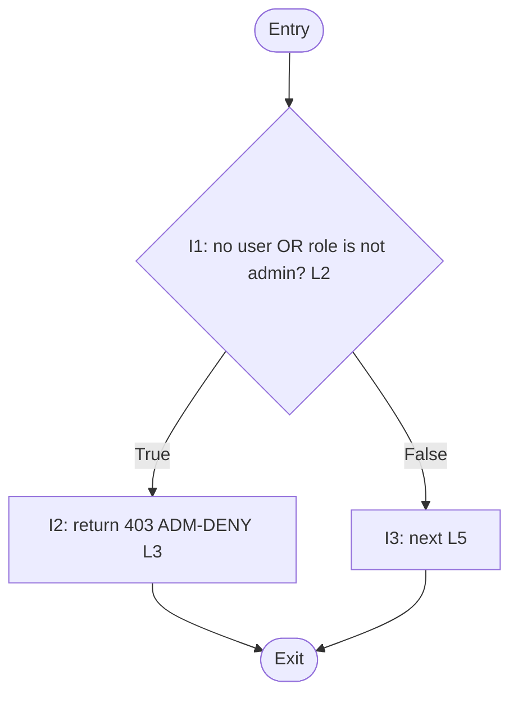
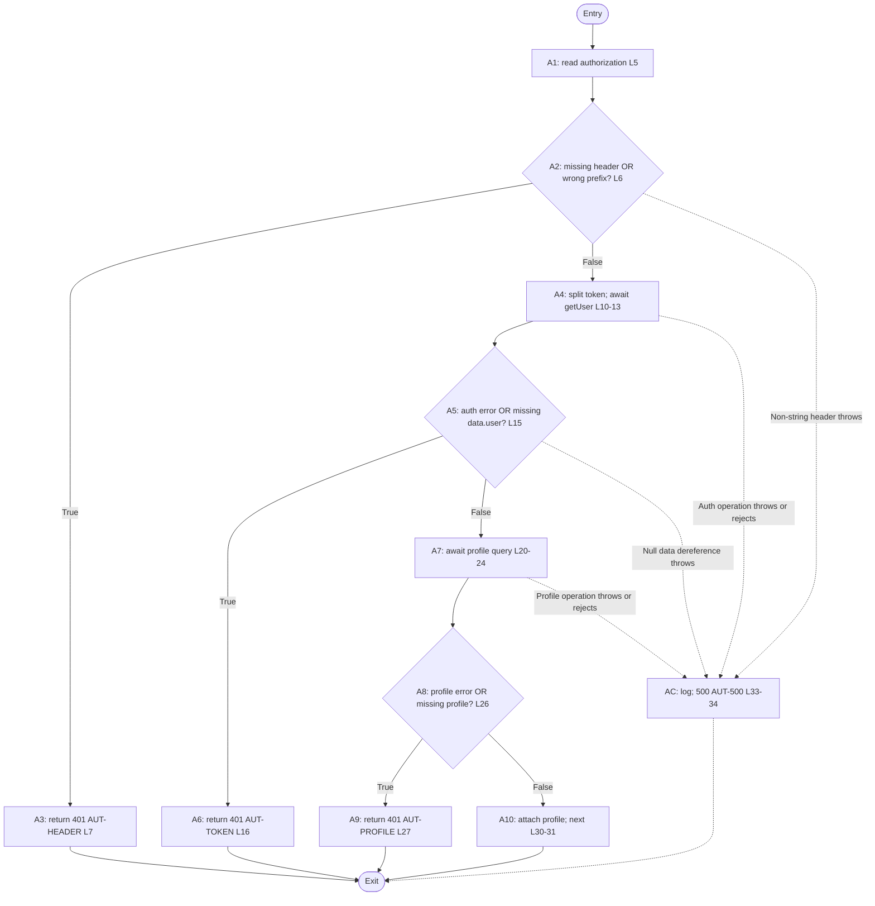
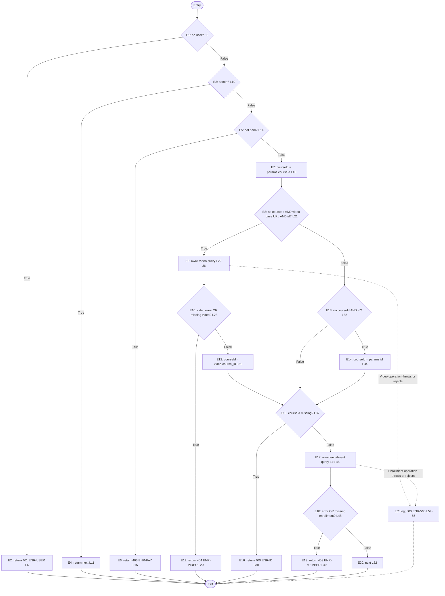

# Section 3.4 — White-Box Testing

**Later execution update (2026-11-25):** the [unit-testing report](unit-testing.md) now records 60 passing Jest tests, including 38 of this document's original design IDs and two replacement TDD cases. All three selected middleware modules measured 100% statement/branch coverage in that run. The [TDD correction](tdd-demonstration.md) supersedes WB-AUT-11: missing identity data now returns 401, so the old null-data-to-catch edge in the authentication diagram no longer applies. The original analysis, Not Run statuses and source line references below are retained as the pre-implementation baseline; they are not the current execution status. See the linked run report for current results, scope and denominators.

## Scope, source baseline and result status

Prepared 2026-11-25 against application baseline `c068e28`. This document fulfils the user's supplied Section 3.4 analysis and test-design scope. The original assignment DOCX is still unavailable; lecturer-specific complexity conventions or additional marking criteria have not been verified.

**This phase is static analysis and test design only: 39 designed cases, all Not Run. No statement, branch, condition or path coverage percentage has been measured.** The earlier [black-box results](black-box-testing.md) remain their own scoped evidence; they are not an instrumented white-box run and are not copied into this phase's actual-result columns.

Selected production modules:

- [isAdmin.js](../backend/middleware/isAdmin.js), lines 1–8: checks the already-attached user's role.
- [authenticate.js](../backend/middleware/authenticate.js), lines 1–38: checks the authorization header, verifies identity through Supabase, and attaches the profile.
- [isEnrolled.js](../backend/middleware/isEnrolled.js), lines 1–59: checks authentication/payment, resolves course identity, and checks membership. This is the detailed case study.

Sources and routing were inspected without changing application logic. [Video routing](../backend/routes/videos.js) mounts `authenticate` then `isEnrolled` on `GET /api/videos/:id/watch`. [Course routing](../backend/routes/courses.js) does **not** mount `isEnrolled`. Consequently, explicit course-ID and course-route fallback paths below require direct middleware invocation; a test of today's course endpoint would not exercise those branches. [Admin routing](../backend/routes/admin.js) mounts `authenticate` then `isAdmin`.

## Coverage and graph conventions

A **statement** is an executable operation, such as assigning a profile or sending a response. **Decision/branch coverage** here means exercising both true and false outcomes of each source `if` or `else if`. **Condition coverage** additionally checks the individual operands of compound expressions when JavaScript evaluates them. Passing through a condition does not imply that every operand was evaluated.

The main CFGs use basic blocks: adjacent straight-line statements can share a node. Entry and exit are explicit. All responses and normal `next()` calls connect to a single conceptual function exit; a response is not an extra decision. A `next()` block describes this middleware passing control, not the control flow of every downstream Express handler. Module imports/exports are outside the function CFG.

**Primary counting convention:** each complete `if`/`else if` expression is one decision, including a compound expression. Solid arrows show normal control flow, including returned SDK error objects that the code tests with an `if`. Dashed arrows show selected exceptional transfers to the catch handler; they are excluded from the primary normal-flow calculation and counted separately below. This separation makes the arithmetic reproducible rather than silently mixing incompatible conventions.

For each connected normal CFG:

`V(G) = E - N + 2P`, where `E` is the number of directed solid edges, `N` is the number of normal nodes, and `P = 1` is the number of connected components. `P` is **not** the number of paths. The cross-check is `number of binary decisions + 1`.

A second, short-circuit-expanded convention gives every evaluated Boolean operand its own decision node. Replacing a two-operand decision adds one node and two edges, increasing V by one; a three-operand decision adds two nodes and four edges, increasing V by two. We report that value too. It is a static syntactic count; repeated predicates and data dependencies can make some syntactic paths infeasible. Neither value is a measured coverage percentage or a universal minimum number of tests.

A third, explicitly scoped exception-overlay calculation includes the dashed catch node/edges. Each modeled throw site adds a new exit from an existing node. With one shared catch block and k distinct throw-site edges, `N' = N + 1`, `E' = E + k + 1`, so `V' = V + k`. The last extra edge is catch-to-exit. Cross-check with `1 + sum(outdegree - 1)` over nonterminal nodes: each extra exception exit adds one. A catch keyword alone is not automatically a binary predicate in this graph. Tools that count a catch as one decision, count logical operators, or instrument expressions can therefore report different numbers.

The overlays cover the exception sites specifically designed here, not every possible JavaScript throw. Unless a case overrides it, request objects have normal Express shapes, plain fixture values have no throwing getters, response/console spies do not throw, and `next` returns normally. Exceptions thrown by response methods, logging, module initialization or downstream callbacks are outside the numerical overlays. They must not be hidden inside a claim of “all possible runtime paths.”

## Shared test design and safety

These are direct middleware unit-test designs, not HTTP integration tests. A future runner should:

1. Replace [supabaseClient.js](../backend/supabaseClient.js) with a strict in-memory mock **before requiring** either dependent middleware, without executing the real credential-reading module. The [existing black-box runner](../tests/black-box/api-checks.cjs) demonstrates import ordering, but is not a white-box coverage harness.
2. Create fresh `req`, chainable `res.status().json()` spies and a `next` spy for each case. Defaults are specified below. Set up only expected SDK calls; unexpected calls fail the test. Reset require-cache/mock state between suites as needed.
3. Invoke the selected function once, awaiting the returned promise for the async middleware. Capture synthetic `console.error` calls for exception cases and restore the spy afterwards.
4. Assert exact HTTP status/body or `next` count, profile assignment, query filters and absence of forbidden later work. A mock rejection uses `Promise.reject(new Error(...))`; a returned error uses a resolved `{data,error}` object. They are different paths.
5. Record actual outputs and sanitized run evidence only after execution. Use deny-by-default network protection. No live Supabase, token, account, payment or enrollment data is needed.

Shared synthetic values: `U = 00000000-0000-4000-8000-000000000003`, `C = 00000000-0000-4000-8000-000000000002`, `V = 00000000-0000-4000-8000-000000000001`; `ERR = {message:'QA synthetic returned error'}`; `PROFILE = {id:U,role:'student',is_paid:true}`; `ENROLL = {student_id:U,course_id:C}`. These identifiers designate mock records only.

Authentication defaults: `req.headers.authorization = 'Bearer qa-fixture-marker'`; no initial `req.user`; `getUser` resolves `{data:{user:{id:U}},error:null}`; profile `single()` resolves `{data:PROFILE,error:null}`. The marker is not a real token. Every query mock supports the exact production chain.

Enrollment defaults: `req.user = {...PROFILE}`, `req.params={courseId:C}`, `req.baseUrl='/api/courses'`; enrollment resolves `{data:ENROLL,error:null}`. “Video context” replaces params with `{id:V}` and baseUrl with `'/api/videos'`. A specified video object is returned as `{data:video,error:null}`. “Explicit C” means the default direct-call course context. Early-return cases reject all unexpected queries.

### Exact response oracle dictionary

In the tables, a response key means `res.status(status).json({error: exact message below})`. For an ordinary denial or exception response, `next` must not be called. Successful middleware sends no response.

| Key | Status | Exact error text |
| --- | --- | --- |
| ADM-DENY | 403 | Forbidden: Admin access required |
| AUT-HEADER | 401 | Missing or invalid authorization header |
| AUT-TOKEN | 401 | Unauthorized: Invalid token |
| AUT-PROFILE | 401 | Profile not found |
| AUT-500 | 500 | Internal server error during authentication |
| ENR-USER | 401 | Unauthorized |
| ENR-PAY | 403 | Forbidden: User has not paid |
| ENR-VIDEO | 404 | Video not found |
| ENR-ID | 400 | Course ID missing for enrollment check |
| ENR-MEMBER | 403 | Forbidden: Not enrolled in this course |
| ENR-500 | 500 | Internal server error checking enrollment |

## 1. isAdmin: purpose, decisions and paths

[Source](../backend/middleware/isAdmin.js): line 2 denies a missing user or a role not exactly equal to `'admin'`; line 3 returns 403; line 5 calls `next()` on success. It performs no database call and does not authenticate a token itself.

The `||` short-circuits: when the user is missing, the role property is not read. A student, missing role or incorrectly capitalized role is denied. There is no local try/catch. A synchronous throw from an injected `next` or response method would propagate to its caller; this module does not promise its own 500 response. Those callback failures are outside the ordinary request contract of the designed cases.

### CFG

Normal nodes N=5; edges E=5; P=1. **V = 5 - 5 + 2 = 2**. Decision method: one `if` + 1 = 2. Expanding its two operands produces N=6, E=7, **V=3** (two atomic decisions + 1). There is no local catch overlay.

### Independent normal paths

| Independent path | Designed test | Normal CFG node sequence |
| --- | --- | --- |
| IP1 | WB-ADM-03 | I0 → I1 → I3 → I4 |
| IP2 | WB-ADM-01 | I0 → I1 → I2 → I4 |

IP2 introduces the deny edge absent from IP1. WB-ADM-02 adds the other short-circuit route to the same deny action; it is required for the expanded condition model even though it is not a third path in the collapsed graph.

### Designed cases

| Test ID | Purpose | Input / mock configuration | Expected outcome and assertions | Structural target | Actual result | Status | Execution evidence |
| --- | --- | --- | --- | --- | --- | --- | --- |
| WB-ADM-01 | No user | Delete req.user | 403 / ADM-DENY; next 0 | I1 true; second operand skipped | Not executed | Not Run | None; design only |
| WB-ADM-02 | Student denied | user={id:U,role:'student'} | 403 / ADM-DENY; next 0 | I1 false-left, true-right | Not executed | Not Run | None; design only |
| WB-ADM-03 | Admin allowed | user={id:U,role:'admin'} | next 1; no response | I1 false/false | Not executed | Not Run | None; design only |
| WB-ADM-04 | Missing role | user={id:U} | 403 / ADM-DENY; next 0 | Undefined role is not admin | Not executed | Not Run | None; design only |
| WB-ADM-05 | Invalid role spelling | user={id:U,role:'Admin'} | 403 / ADM-DENY; next 0 | Exact case-sensitive comparison | Not executed | Not Run | None; design only |

Statement-target suite: WB-ADM-01 and WB-ADM-03 cover the denial response and `next()`. Decision-branch target: the same pair covers I1 true/false. Condition/short-circuit target: add WB-ADM-02 to obtain (true, skipped), (false, true), (false, false). These are design claims, not execution results.

## 2. authenticate: purpose, decisions and paths

[Source](../backend/middleware/authenticate.js):

1. Read authorization (line 5); reject a missing header or a value without the exact `Bearer ` prefix (lines 6–7).
2. Split on a space and take element 1 (line 10), then await `getUser` (line 13).
3. Reject a returned SDK error or missing `data.user` (lines 15–16).
4. Query the matching profile (lines 20–24); reject a returned profile error or missing profile (lines 26–27).
5. Assign the returned profile to `req.user` and continue (lines 30–31).
6. A thrown exception or rejected awaited promise inside the try reaches logging and the 500 response (lines 32–34).

There are three source decisions, each with two OR operands. A returned error is a normal result checked by a decision; it is not a thrown exception. Missing `data.user` with `data={user:null}` returns 401, while `data=null,error=null` causes a property-access exception and the catch returns 500. A truthy `error` short-circuits the property access.

### CFG with selected exception overlay

Normal nodes A0–A11: N=12; solid E=14; P=1. **V = 14 - 12 + 2 = 4**. Cross-check: three `if` decisions + 1 = 4.

Short-circuit expansion adds three nodes and six edges: N=15, E=20; **V=7**, matching six atomic predicates + 1.

Including the shown exception overlay adds AC and five dashed edges (four throw sites plus catch-to-exit): N=13, E=19; **V=8**. Cross-check: 1 + 3 normal decisions + 4 additional exception exits = 8. The malformed-header edge is a defensive direct-call case, not a claim that Express normally supplies numeric headers.

### Independent normal and modeled exception paths

| Independent path | Designed test | Normal CFG node sequence |
| --- | --- | --- |
| AP1 | WB-AUT-07 | A0 → A1 → A2 → A4 → A5 → A7 → A8 → A10 → A11 |
| AP2 | WB-AUT-01 | A0 → A1 → A2 → A3 → A11 |
| AP3 | WB-AUT-03 | A0 → A1 → A2 → A4 → A5 → A6 → A11 |
| AP4 | WB-AUT-05 | A0 → A1 → A2 → A4 → A5 → A7 → A8 → A9 → A11 |

Each path after AP1 introduces a distinct early-response edge. For the illustrated exception-aware graph, these four additional paths introduce distinct exception edges, giving eight independent paths in that model:

| Path | Test | Node sequence |
| --- | --- | --- |
| AP5 | WB-AUT-12 | A0 → A1 → A2 → AC → A11 |
| AP6 | WB-AUT-08 | A0 → A1 → A2 → A4 → AC → A11 |
| AP7 | WB-AUT-11 | A0 → A1 → A2 → A4 → A5 → AC → A11 |
| AP8 | WB-AUT-09 | A0 → A1 → A2 → A4 → A5 → A7 → AC → A11 |

### Designed cases

| Test ID | Purpose | Input / mock configuration | Expected outcome and assertions | Structural target | Actual result | Status | Execution evidence |
| --- | --- | --- | --- | --- | --- | --- | --- |
| WB-AUT-01 | Missing header | headers={}; reject any SDK call | 401 / AUT-HEADER; next 0; user not assigned | A2 true-left | Not executed | Not Run | None; design only |
| WB-AUT-02 | Wrong scheme | authorization='Basic synthetic'; reject any SDK call | 401 / AUT-HEADER; next 0; user not assigned | A2 false-left, true-right | Not executed | Not Run | None; design only |
| WB-AUT-03 | Returned auth error wins | getUser resolves {data:{user:{id:U}},error:ERR} | 401 / AUT-TOKEN; no profile query; next 0 | A5 true-left; right skipped even with user | Not executed | Not Run | None; design only |
| WB-AUT-04 | Missing auth user | getUser resolves {data:{user:null},error:null} | 401 / AUT-TOKEN; no profile query; next 0 | A5 false-left, true-right | Not executed | Not Run | None; design only |
| WB-AUT-05 | Returned profile error wins | Valid auth; single resolves {data:PROFILE,error:ERR} | 401 / AUT-PROFILE; next 0; user not assigned | A8 true-left | Not executed | Not Run | None; design only |
| WB-AUT-06 | Missing profile | Valid auth; single resolves {data:null,error:null} | 401 / AUT-PROFILE; next 0; user not assigned | A8 false-left, true-right | Not executed | Not Run | None; design only |
| WB-AUT-07 | Successful authentication | Valid auth; profile lookup resolves {data:PROFILE,error:null} | req.user is PROFILE; next 1; no response; profiles query filters id=U | All three decisions false | Not executed | Not Run | None; design only |
| WB-AUT-08 | Rejected auth promise | getUser rejects Error('QA auth failure') | 500 / AUT-500; logged synthetic error; next 0; no profile query | A4 exception -> AC | Not executed | Not Run | None; design only |
| WB-AUT-09 | Rejected profile promise | Valid auth; profile single rejects Error('QA profile failure') | 500 / AUT-500; logged synthetic error; next 0 | A7 exception -> AC | Not executed | Not Run | None; design only |
| WB-AUT-10 | Empty bearer value | authorization='Bearer '; getUser('') returns {data:{user:null},error:ERR} | Empty string forwarded to getUser; 401 / AUT-TOKEN from mock result; next 0 | Prefix check accepts empty token; no invented length rule | Not executed | Not Run | None; design only |
| WB-AUT-11 | Malformed dependency envelope | getUser resolves {data:null,error:null} | TypeError while evaluating data.user; 500 / AUT-500; logged; next 0 | A5 exception, distinct from data.user=null | Not executed | Not Run | None; design only |
| WB-AUT-12 | Malformed direct-call header | authorization=42; reject any SDK call | TypeError on startsWith; 500 / AUT-500; logged; next 0 | A2 exception; defensive unit input, not normal Express header | Not executed | Not Run | None; design only |

Statement-target suite: WB-AUT-01, 03, 05, 07 and 08 collectively target all executable body blocks including catch logging/response. It does not follow that one catch test covers every exception source. Decision-branch target: WB-AUT-01, 03, 05, 07 gives both outcomes for A2/A5/A8. Add WB-AUT-02/04/06 for the alternative OR operands; WB-AUT-08/09/11/12 target all illustrated exception edges. WB-AUT-10 characterizes the empty-token path, not the real Supabase token policy.

## 3. isEnrolled: detailed white-box case study

### Purpose and ordered control flow

[Source](../backend/middleware/isEnrolled.js):

- Lines 5–6 reject a missing `req.user` with 401.
- Lines 10–11 let an admin continue immediately. Payment, course ID and enrollment do not matter for this bypass.
- Lines 14–15 reject every remaining user with a falsy `is_paid` value.
- Line 18 starts with `req.params.courseId`.
- Line 21 enters video lookup only when there is no course ID, the base URL contains `/videos`, and an ID exists. Lines 22–29 query the video and return 404 for a returned error or absent row. Line 31 takes the video's course ID.
- Only when the whole video condition is false does the `else if` at line 32 run. If the course ID is absent and `params.id` exists, line 34 uses that ID as a course ID.
- Lines 37–38 reject a still-falsy course ID with 400.
- Lines 41–49 query enrollment by both authenticated profile ID and resolved course ID, returning 403 for a returned error or absent row.
- Line 52 continues on success. Lines 54–55 log and send 500 for exceptions caught by the surrounding try.

This order matters. An unpaid student is denied before any video lookup, including a missing-video request. A successfully returned video object with a null course ID leads to 400; it does not re-enter the fallback. A supplied `params.courseId` takes precedence even on a video-shaped route.

The middleware has no UUID validator, exact Boolean check or explicit student-role allowlist. Unexpected roles and truthy non-Boolean payment values therefore need characterization cases. The [SQL schema](../database_setup.sql) constrains stored role/Boolean values, but a direct unit fixture can supply values outside that schema to show what this function itself does. Such a test is not evidence that production can store those values.

### Decisions and conditions

| Decision / source line | Full predicate | True action | False action | Atomic conditions |
| --- | --- | --- | --- | --- |
| E1 / L5 | !req.user | 401 ENR-USER | Check role | 1 |
| E3 / L10 | req.user.role === 'admin' | next; return | Check payment | 1 |
| E5 / L14 | !req.user.is_paid | 403 ENR-PAY | Resolve course ID | 1 |
| E8 / L21 | !courseId && req.baseUrl.includes('/videos') && req.params.id | Query video | Evaluate fallback E13 | 3 |
| E10 / L28 | videoError \|\| !video | 404 ENR-VIDEO | Assign video.course_id | 2 |
| E13 / L32 | !courseId && req.params.id | Assign fallback ID | Leave current ID | 2 |
| E15 / L37 | !courseId | 400 ENR-ID | Query enrollment | 1 |
| E18 / L48 | error \|\| !enrollment | 403 ENR-MEMBER | next | 2 |

There are **eight source decisions and thirteen atomic conditions**. `else if` counts as a decision; `else`, query chaining, assignment, `await` and `return` do not count as normal Boolean decisions. JavaScript uses truthiness for the ID and payment expressions.

### CFG with dependency-exception overlay

### Cyclomatic complexity, with auditable counts

Normal nodes are E0–E21: **N=22**. The eight decision nodes each have two solid outgoing edges (16 total); thirteen other nonterminal nodes each have one (13 total); the exit has none. Thus **E=29**, **P=1**:

`V(G) = 29 - 22 + 2(1) = 9`.

Decision-point cross-check: `8 + 1 = 9`.

Short-circuit expansion adds two nodes for the three-operand E8 and one each for E10, E13 and E18: five additional nodes and ten additional edges. Therefore N=27, E=39:

`V_atomic = 39 - 27 + 2 = 14 = 13 atomic decisions + 1`.

The shown exception overlay adds EC and the three dashed edges. N=23, E=32:

`V_with_shown_exceptions = 32 - 23 + 2 = 11 = 1 + 8 normal decisions + 2 exception exits`.

The primary **9**, expanded **14** and exception-overlay **11** refer to different declared graphs, so they must not be presented as contradictory measurements or added together. Combining both expansions would define yet another graph. No generated coverage-tool complexity report is claimed.

### Feasible independent normal paths

A basis path is independent when its edge-incidence vector cannot be formed from the previous vectors. The following ordered paths each introduce at least one previously unused edge. All are feasible for direct unit invocation with the fixtures specified in their cases.

| Independent path | Designed test | Normal CFG node sequence |
| --- | --- | --- |
| EP1 | WB-ENR-08 | E0 → E1 → E3 → E5 → E7 → E8 → E9 → E10 → E12 → E15 → E17 → E18 → E20 → E21 |
| EP2 | WB-ENR-01 | E0 → E1 → E2 → E21 |
| EP3 | WB-ENR-02 | E0 → E1 → E3 → E4 → E21 |
| EP4 | WB-ENR-03 | E0 → E1 → E3 → E5 → E6 → E21 |
| EP5 | WB-ENR-05 | E0 → E1 → E3 → E5 → E7 → E8 → E9 → E10 → E11 → E21 |
| EP6 | WB-ENR-07 | E0 → E1 → E3 → E5 → E7 → E8 → E9 → E10 → E12 → E15 → E17 → E18 → E19 → E21 |
| EP7 | WB-ENR-04 | E0 → E1 → E3 → E5 → E7 → E8 → E13 → E15 → E17 → E18 → E20 → E21 |
| EP8 | WB-ENR-09 | E0 → E1 → E3 → E5 → E7 → E8 → E13 → E14 → E15 → E17 → E18 → E20 → E21 |
| EP9 | WB-ENR-10 | E0 → E1 → E3 → E5 → E7 → E8 → E13 → E15 → E16 → E21 |

EP1 is the successful video path. EP2–EP6 add the missing-user, admin, unpaid, missing-video and missing-enrollment exits. EP7 adds explicit-course resolution, EP8 adds fallback assignment, and EP9 adds the missing-course exit. These nine paths match the primary V=9.

The dependency-exception overlay has two more independent paths:

| Path | Test | Node sequence |
| --- | --- | --- |
| EP10 | WB-ENR-13 | E0 → E1 → E3 → E5 → E7 → E8 → E9 → EC → E21 |
| EP11 | WB-ENR-14 | E0 → E1 → E3 → E5 → E7 → E8 → E13 → E15 → E17 → EC → E21 |

Additional tests need not introduce independent collapsed-graph paths to be valuable. WB-ENR-06 distinguishes a missing row from an SDK error; WB-ENR-11 checks bad video metadata; WB-ENR-15 distinguishes a third-operand failure in E8. The expanded graph's syntactic count of 14 does not prove 14 independently feasible request paths: for example, when E8's first operand is false because courseId exists, E13's first operand must also be false unless some intervening operation changes that value. Here none does. Exhaustive combinations or MC/DC coverage are not claimed.

### Designed cases

| Test ID | Purpose | Input / mock configuration | Expected outcome and assertions | Structural target | Actual result | Status | Execution evidence |
| --- | --- | --- | --- | --- | --- | --- | --- |
| WB-ENR-01 | Missing user | Delete user; reject any SDK call | 401 / ENR-USER; next 0 | E1 T | Not executed | Not Run | None; design only |
| WB-ENR-02 | Admin bypass | user={id:U,role:'admin',is_paid:false}; params={}; reject SDK calls | next 1; no response; no payment, ID or enrollment check | E1 F; E3 T | Not executed | Not Run | None; design only |
| WB-ENR-03 | Unpaid student | user.is_paid=false; reject SDK calls | 403 / ENR-PAY; next 0 | E3 F; E5 T | Not executed | Not Run | None; design only |
| WB-ENR-04 | Explicit course success | params={courseId:C}; baseUrl='/api/courses'; enrollment=ENROLL | Only enrollment lookup with student_id=U/course_id=C; next 1; no response | E8 F; E13 F; E15 F; E18 F | Not executed | Not Run | None; design only |
| WB-ENR-05 | Video query returned error | Video context; video result={data:null,error:ERR} | 404 / ENR-VIDEO; no enrollment query; next 0 | E8 T; E10 T-left | Not executed | Not Run | None; design only |
| WB-ENR-06 | Video absent without error | Video context; video result={data:null,error:null} | 404 / ENR-VIDEO; no enrollment query; next 0 | E10 F-left/T-right | Not executed | Not Run | None; design only |
| WB-ENR-07 | Video found, enrollment absent | Video context; video={course_id:C}; enrollment result={data:null,error:null} | 403 / ENR-MEMBER; query U/C; next 0 | E10 F; E12; E18 F-left/T-right | Not executed | Not Run | None; design only |
| WB-ENR-08 | Video found and enrolled | Video context; video={course_id:C}; enrollment=ENROLL | videos query id=V; enrollment query U/C; next 1; no response | E8 T; E10 F; E15 F; E18 F | Not executed | Not Run | None; design only |
| WB-ENR-09 | Course-ID fallback | params={id:C}; baseUrl='/api/courses'; enrollment=ENROLL | No videos lookup; courseId becomes C; enrollment query U/C; next 1 | E8 middle operand F; E13 T; E14 | Not executed | Not Run | None; design only |
| WB-ENR-10 | Missing all course identifiers | params={}; baseUrl='/api/courses'; reject SDK calls | 400 / ENR-ID; next 0; no query | E8 F; E13 F; E15 T | Not executed | Not Run | None; design only |
| WB-ENR-11 | Video lacks usable course_id | Video context; video={course_id:null}, error=null | 400 / ENR-ID; no enrollment query; next 0; no fallback after successful video branch | E10 F; E12; E15 T | Not executed | Not Run | None; design only |
| WB-ENR-12 | Enrollment returned error | Explicit course context; enrollment result={data:null,error:ERR} | 403 / ENR-MEMBER; next 0 | E18 T-left | Not executed | Not Run | None; design only |
| WB-ENR-13 | Video lookup rejects | Video context; videos.single rejects Error('QA video failure') | 500 / ENR-500; logged; no enrollment query; next 0 | E9 exception -> EC | Not executed | Not Run | None; design only |
| WB-ENR-14 | Enrollment lookup rejects | Explicit course context; enrollments.single rejects Error('QA enrollment failure') | 500 / ENR-500; logged; next 0 | E17 exception -> EC | Not executed | Not Run | None; design only |
| WB-ENR-15 | Video base URL but no id | params={}; baseUrl='/api/videos'; reject SDK calls | 400 / ENR-ID; next 0; no query | E8 first two operands T, last F; E13 F | Not executed | Not Run | None; design only |
| WB-ENR-16 | Explicit course takes precedence | params={courseId:C,id:V}; baseUrl='/api/videos'; enrollment=ENROLL | No videos lookup; enrollment query U/C; next 1 | E8 first F; E13 first F; supplied id ignored | Not executed | Not Run | None; design only |
| WB-ENR-17 | Invalid course identifier forwarded | params={courseId:'not-a-uuid'}; mock enrollment result={data:null,error:ERR} | Enrollment filter receives literal invalid value; 403 / ENR-MEMBER; next 0; no local UUID validator | E18 T based on configured returned error; not real DB evidence | Not executed | Not Run | None; design only |
| WB-ENR-18 | Unexpected paid role | user={id:U,role:'teacher',is_paid:true}; explicit C; enrollment=ENROLL | next 1; no response; non-admin follows paid/enrollment path | Characterization: no explicit student-role check here | Not executed | Not Run | None; design only |
| WB-ENR-19 | Truthy non-Boolean payment | user.is_paid='false'; explicit C; enrollment=ENROLL | next 1; no response; string is truthy | Characterization: !is_paid is a truthiness test | Not executed | Not Run | None; design only |
| WB-ENR-20 | Missing payment flag | Delete user.is_paid; reject SDK calls | 403 / ENR-PAY; next 0 | Missing value is falsy | Not executed | Not Run | None; design only |
| WB-ENR-21 | Video data and error both present | Video context; result={data:{course_id:C},error:ERR} | 404 / ENR-VIDEO; next 0; no enrollment query | E10 left error wins; right skipped | Not executed | Not Run | None; design only |
| WB-ENR-22 | Enrollment data and error both present | Explicit C; result={data:ENROLL,error:ERR} | 403 / ENR-MEMBER; next 0 | E18 left error wins; right skipped | Not executed | Not Run | None; design only |

### Statement-coverage design for the main case study

This table maps executable blocks rather than inventing an instrumenter's statement denominator. Predicate evaluation itself is covered by the path suite; import/export execution will depend on the future runner's instrumentation.

| Statement/block | Source lines | Designed witnesses | Expected observable effect |
| --- | --- | --- | --- |
| Missing-user response | 6 | WB-ENR-01 | 401 ENR-USER |
| Admin next and return | 11 | WB-ENR-02 | next once, no query |
| Unpaid response | 15 | WB-ENR-03 | 403 ENR-PAY |
| Initial course ID assignment | 18 | WB-ENR-04 / 08 | Uses supplied C or proceeds to video lookup |
| Video query chain | 22–26 | WB-ENR-05 / 08 | select course_id; filter id=V |
| Video-error response | 29 | WB-ENR-05 | 404 ENR-VIDEO |
| Video-derived ID assignment | 31 | WB-ENR-08 | Enrollment filters course_id=C |
| Fallback ID assignment | 34 | WB-ENR-09 | Enrollment filters params.id as course_id |
| Missing-ID response | 38 | WB-ENR-10 | 400 ENR-ID |
| Enrollment query chain | 41–46 | WB-ENR-07 / 08 | Filters student_id=U and course_id=C |
| Enrollment denial response | 49 | WB-ENR-07 | 403 ENR-MEMBER |
| Student success next | 52 | WB-ENR-08 | next once, no response |
| Catch logging and response | 54–55 | WB-ENR-13 / 14 | Log synthetic error and 500 ENR-500 |

A candidate statement-target subset is **WB-ENR-01, 02, 03, 05, 07, 08, 09, 10, 13**. Add WB-ENR-04 to target E13's false outcome even when courseId already exists; add WB-ENR-14 for the other shown exception site. Use the full designed suite for operand/data cases. This is a review of planned reachability, not a claim that a runner has measured complete coverage.

## Cross-module branch-to-test traceability

“T/F” means the entire decision's Boolean outcome. Only cases that reach that decision can count toward it; an earlier denial does not exercise later false branches.

| Branch ID / source | True witness and expected action | False witness and expected action |
| --- | --- | --- |
| I1, isAdmin L2 | WB-ADM-01/02 → 403 ADM-DENY | WB-ADM-03 → next |
| A2, authenticate L6 | WB-AUT-01/02 → 401 AUT-HEADER | WB-AUT-07 → token verification |
| A5, authenticate L15 | WB-AUT-03/04 → 401 AUT-TOKEN | WB-AUT-07 → profile query |
| A8, authenticate L26 | WB-AUT-05/06 → 401 AUT-PROFILE | WB-AUT-07 → assign req.user; next |
| E1, isEnrolled L5 | WB-ENR-01 → 401 ENR-USER | WB-ENR-02 → role check |
| E3, isEnrolled L10 | WB-ENR-02 → next; bypass | WB-ENR-03 → payment check |
| E5, isEnrolled L14 | WB-ENR-03 → 403 ENR-PAY | WB-ENR-08 → course resolution |
| E8, isEnrolled L21 | WB-ENR-08 → video lookup | WB-ENR-04/09/15 → fallback decision |
| E10, isEnrolled L28 | WB-ENR-05/06 → 404 ENR-VIDEO | WB-ENR-08 → assign video course ID |
| E13, isEnrolled L32 | WB-ENR-09 → assign params.id | WB-ENR-04/10 → no fallback assignment |
| E15, isEnrolled L37 | WB-ENR-10/11 → 400 ENR-ID | WB-ENR-08 → enrollment query |
| E18, isEnrolled L48 | WB-ENR-07/12 → 403 ENR-MEMBER | WB-ENR-08 → next |

### Compound-condition traceability

Operand order is source order. `-` means **not evaluated**, not false. The table designs both truth values for each evaluated operand, while respecting short-circuit evaluation. It is not an MC/DC claim.

| Decision | Operand evaluation patterns and witnesses | Expected outcomes |
| --- | --- | --- |
| I1: missing user OR wrong role | T,-: ADM-01; F,T: ADM-02; F,F: ADM-03 | deny; deny; allow |
| A2: missing header OR wrong prefix | T,-: AUT-01; F,T: AUT-02; F,F: AUT-07 | header denial; header denial; verify |
| A5: auth error OR missing user | T,-: AUT-03; F,T: AUT-04; F,F: AUT-07 | token denial; token denial; profile |
| A8: profile error OR missing profile | T,-: AUT-05; F,T: AUT-06; F,F: AUT-07 | profile denial; profile denial; next |
| E8: missing courseId AND video base URL AND id | F,-,-: ENR-16; T,F,-: ENR-09; T,T,F: ENR-15; T,T,T: ENR-08 | fallback check for first three; video lookup for last |
| E10: video error OR missing video | T,-: ENR-05/21; F,T: ENR-06; F,F: ENR-08 | 404; 404; assign ID |
| E13: missing courseId AND id | F,-: ENR-04/16; T,F: ENR-10/15; T,T: ENR-09 | no assignment; no assignment; fallback assignment |
| E18: enrollment error OR missing enrollment | T,-: ENR-12/22; F,T: ENR-07; F,F: ENR-08 | 403; 403; next |

Abbreviated case names in this operand table have the prefix `WB-`; for example ENR-08 means WB-ENR-08. Single-condition decisions E1/E3/E5/E15 are already covered in the branch table.

### Exception traceability

| Throw site / catch | Designed case | Expected outcome | Distinction |
| --- | --- | --- | --- |
| A4 → AC | WB-AUT-08 | 500 AUT-500; log; no profile query | Rejected promise, not returned auth error |
| A7 → AC | WB-AUT-09 | 500 AUT-500; log; no req.user assignment | Rejected profile query, not missing row |
| A5 → AC | WB-AUT-11 | 500 AUT-500; log | Malformed null data envelope; property access throws |
| A2 → AC | WB-AUT-12 | 500 AUT-500; log; no SDK call | Non-string direct-call input |
| E9 → EC | WB-ENR-13 | 500 ENR-500; log; no enrollment query | Video promise rejects, unlike 404 on returned error |
| E17 → EC | WB-ENR-14 | 500 ENR-500; log; next 0 | Enrollment promise rejects, unlike 403 on returned error |

An SDK query builder throwing synchronously inside either query block also reaches the same depicted exception edge. A later extension may test that variation separately; the current rejection cases must not be reported as having executed it. A rejected promise returned by a downstream callback is not automatically equivalent to a rejected `await` in this function, so these cases deliberately use a normal synchronous `next` spy.

## Complexity and planned coverage summary

| Module | Normal N | Normal E | P | Normal V | Decision cross-check | Atomic N / E / V | Shown exception-overlay N / E / V | Designed cases / execution |
| --- | --- | --- | --- | --- | --- | --- | --- | --- |
| isAdmin | 5 | 5 | 1 | 2 | 1 + 1 = 2 | 6 / 7 / 3 | No local catch overlay | 5 / all Not Run |
| authenticate | 12 | 14 | 1 | 4 | 3 + 1 = 4 | 15 / 20 / 7 | 13 / 19 / 8 | 12 / all Not Run |
| isEnrolled | 22 | 29 | 1 | 9 | 8 + 1 = 9 | 27 / 39 / 14 | 23 / 32 / 11 | 22 / all Not Run |

All 12 source decisions have designed true/false witnesses, all eight compound predicates have operand-evaluation witnesses, and both catch blocks have designed logging/response witnesses. These are **design traceability totals**, not measured branch/condition/statement coverage. Total cases: **39 Not Run; no Pass or Fail results assigned**.

For later measurement, run instrumented unit tests against these actual middleware files, include all three files in the instrumentation scope (including initially unexecuted files), and retain the command, tool/version/configuration, source revision, test results and raw coverage report. Report the tool's statement/branch/function/line denominators and explain any distinction from the CFG decision convention. A test suite can pass while missing branches. Do not infer 100% from case design, the complexity number, or the prior black-box passes.

## Findings, limitations and next implementation step

- The conditional order and exact messages are source-derived implementation expectations. Missing-data/error cases use synthetic dependencies; no actual Supabase behavior is asserted.
- A null auth response envelope, truthy non-Boolean payment or unexpected role is a boundary of the current function contract. The cases document behavior and possible hardening questions, not newly reproduced production defects.
- Several enrollment branches are unused by current router wiring but feasible through direct function calls. Whole-application path reachability must be reported separately.
- The normal basis is feasible under the declared unit fixtures. The short-circuit-expanded count does not certify feasibility of every path through its syntactic graph.
- Statement counts depend on tooling and how multi-line query chains/exports are instrumented. This report intentionally does not invent such counts.
- No implementation tests or coverage run were requested in this phase. A safe next implementation step is to add isolated unit suites from these designs and a coverage configuration; application refactoring is unnecessary for these exported middleware functions.
- The local black-box browser fixture remains stopped. This analysis needs no browser, new package, database or external service.

## Phase record

Working directory: `D:\projects\tutorial-platform`. Changed files in this phase: [this report](white-box-testing.md), [assignment checklist](assignment-checklist.md), and [testing roadmap](testing-roadmap.md). Existing staged work and earlier evidence were preserved. No application logic, schema, package, test runner or previous result file was changed.

Inspection commands: `Get-Content -Encoding UTF8` for the three middleware files, video/course/admin routers and prior documents; a numbered PowerShell source listing; `rg --files` for local instructions/related reports; `git status --short`. The source read established all decisions, line references and routing limitations described above. No repository AGENTS file was found in the checked workspace/parent locations. A missing-file check was an inspection outcome, not an application test failure.

### Actual document-verification results

The following checks validate this analysis, not the application's runtime behavior.

| Command / activity | Actual result |
| --- | --- |
| `git log -1 --format=%h` | Exit 0; baseline c068e28 confirmed |
| `git diff HEAD --exit-code -- backend frontend database_setup.sql .gitignore` | Exit 0; no staged or unstaged application/schema/package/ignore changes against HEAD |
| Node document validator supplied through PowerShell standard input (`@' ... '@ \| node`), using fs/assert and explicit CFG edge/path lists | Exit 0; three Mermaid graph structures checked against the listed edges; all node references resolve; normal N/E/V values 5/5/2, 12/14/4, 22/29/9 match source decision counts |
| Same validator: source logical-operator count and exception-edge arithmetic | Atomic V values 3/7/14; shown exception-inclusive values 8 for authentication and 11 for enrollment; no catch overlay for admin |
| Same validator: path-edge validity and binary edge-incidence matrix elimination | Normal independent-path ranks 2/4/9; illustrated exception-inclusive path ranks 8/11; every listed path edge exists in its declared graph |
| Same validator: test IDs/statuses/references, Markdown fences and relative links | 39 unique design rows, all Not Run; referenced full test IDs exist; fences balanced; 300 relative links across the documentation package resolve on final recheck |
| Editor diagnostics for the three changed Markdown files | No errors reported |

The verifier was rerun after adding the exception-path independence check and again exited 0. It read source as text; it did not import middleware, execute application cases or instrument production code. Mermaid nodes/edges and arithmetic were checked programmatically; visual diagram rendering was not tested. Source SHA-256 values were calculated during verification to identify the inspected bytes; no runtime coverage report was generated.

**Application test execution: Not Run. Coverage: Not measured.** There are no test screenshots or runtime white-box evidence files to cite. The requested analysis/design deliverable is prepared; execution, measured coverage and original-rubric reconciliation remain future work.

